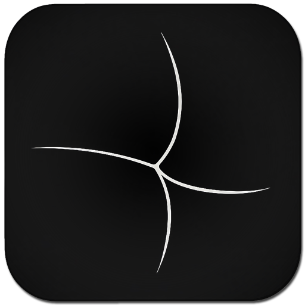

[English](README.md) · [Русский](.readme/lang/ru/README.md)

  

<h1 align="center">BarkFluff</h1>

  <strong>A self-hosted messaging platform engineered for real-time, distributed systems.</strong>

  <a href="#download">Download</a> ·
  <a href="#what-is-inside">Platform</a> ·
  <a href="#clients">Clients</a> ·
  <a href="Obsidian/ClaudeVault/Index.md">Project notes</a>

  
  
  
  
  

---

BarkFluff pairs native clients with a gRPC-first .NET backend. Clients discover their service endpoints through Beacon, receive live changes through streaming updates, and communicate with independent services that can evolve and scale without turning the product into a distributed tangle.

  

## Download

[Download for Windows](https://storage.barkfluff.com/get/barkfluffwindows/release) · [Download for Android](https://storage.barkfluff.com/get/barkfluffkotlin/release) · [Download for macOS](https://storage.barkfluff.com/get/barkfluffmacos/release)

  Windows, Android, and macOS release builds. Other clients are available from source below.

## What is inside

**One entry point.** Beacon lets clients discover a node's service endpoints; Settings stores the services' runtime configuration.

**Independent product services.** Identity, profiles, messaging, files, presence, calls, bots, federation, and more run as focused .NET services, with CQRS and MediatR where they fit.

**Real-time by default.** The Updates service uses persistent gRPC streams for live product events, while RabbitMQ carries asynchronous work between services.

**Built to operate.** PostgreSQL stores state, Redis serves hot data, MinIO handles objects, and Docker runs the stack. Native and web clients are built with Kotlin, WinUI, SwiftUI, Qt, and web technologies.

Read the [project architecture notes](Obsidian/ClaudeVault/Architecture.md) for ports, authentication, event delivery, and service conventions.

## Clients

- **Android** — Kotlin and gRPC-OkHttp · [project notes](Obsidian/ClaudeVault/Clients/Android.md)
- **Windows** — WinUI 3 and .NET · [project notes](Obsidian/ClaudeVault/Clients/Windows-WinUI.md) · WPF client (legacy)
- **macOS** — SwiftUI and gRPC-Swift · [project notes](Obsidian/ClaudeVault/Clients/macOS.md)
- **iOS** — SwiftUI and gRPC-Swift · [project notes](Obsidian/ClaudeVault/Clients/iOS.md)
- **Linux** — Qt 6, C++20, and gRPC · [project notes](Obsidian/ClaudeVault/Clients/Linux-Qt.md)
- **Web** — gRPC-Web and a vanilla-JS SPA · [project notes](Obsidian/ClaudeVault/Clients/Web.md)

## Explore the repository

> ### 🧩 Platform
> [`Backend/`](Backend) contains the .NET microservices and web hosts. [`Shared/`](Shared) holds protobuf contracts and common .NET libraries.

> ### 📱 Clients
> [`Android/`](Android), [`Windows/`](Windows), [`Mac/`](Mac), [`iOS/`](iOS), and [`Linux/`](Linux) contain the native applications. [`Frontend/`](Frontend) contains the developer portal frontend.

> ### ⚙️ Infrastructure
> [`Docker/`](Docker) contains local platform and infrastructure stacks. [`Tests/`](Tests) contains automated and load tests.

> ### 📖 Documentation
> [Project knowledge base](Obsidian/ClaudeVault/Index.md) contains architecture, component, and testing notes.

## Project status

> ### 🚧 Actively developed
> BarkFluff is under active development. The Android client is built from the `app-v1` module; Jetpack Compose is used for selected screens alongside Views/XML.

> ### ✅ Build health
> Workflow status is shown above. Open [GitHub Actions](https://github.com/Liis17/BarkFluff/actions) for the full matrix.

## Reference & documentation

> ### 🛠️ Run and operate
> [Architecture and deployment](Obsidian/ClaudeVault/Architecture.md) · [Settings](Obsidian/ClaudeVault/Backend/Settings.md) · [Initial setup UI](Obsidian/ClaudeVault/Backend/Setup.md) · [Testing](Obsidian/ClaudeVault/Testing.md)

> ### 🤖 Integrate a bot
> [Bot API and service notes](Obsidian/ClaudeVault/Backend/Bots.md) — capabilities, authentication, and REST endpoints for external bots.

> ### 📚 Learn the system
> [Project knowledge base](Obsidian/ClaudeVault/Index.md)

> ### ⚖️ License
> [MIT License](LICENSE)
